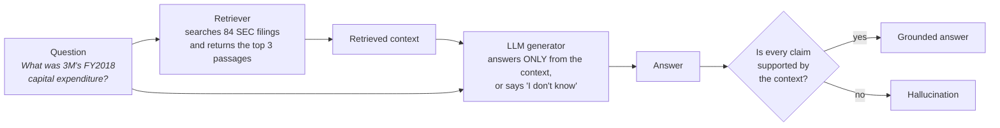
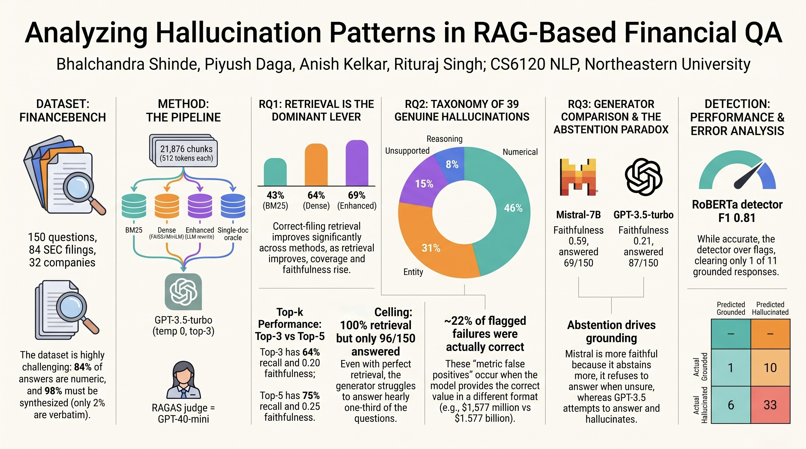
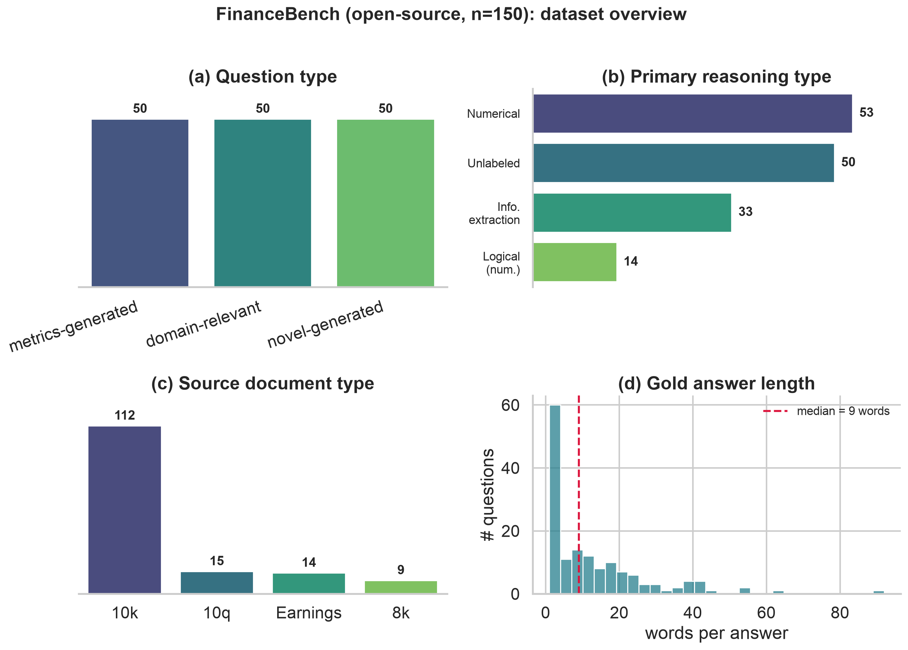
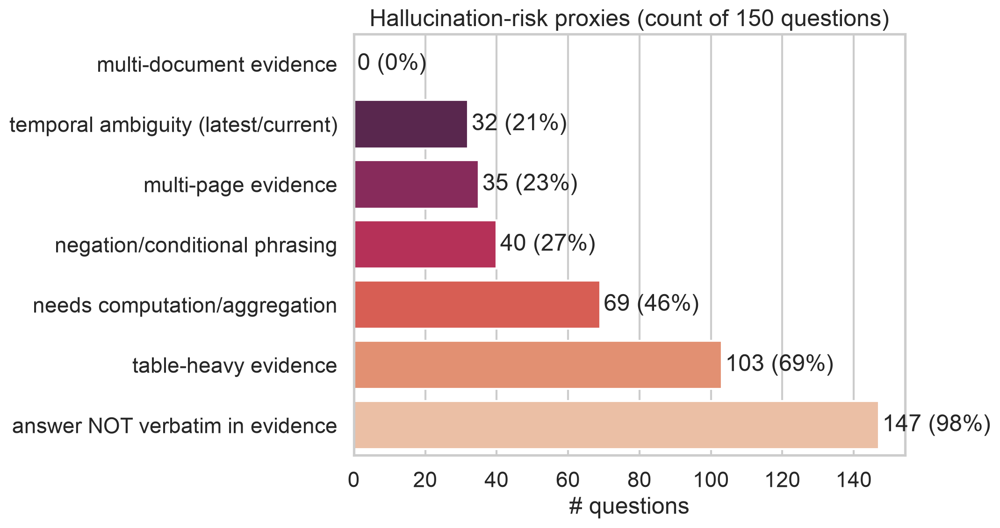
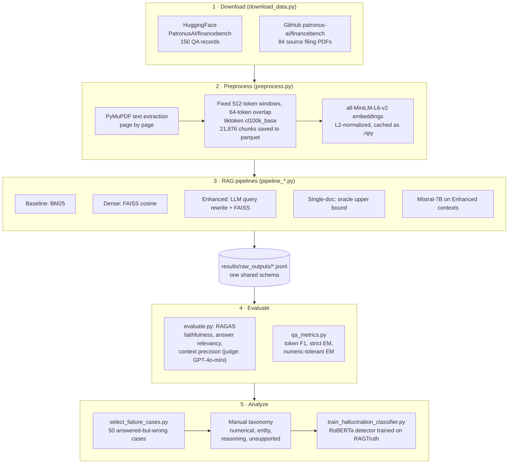
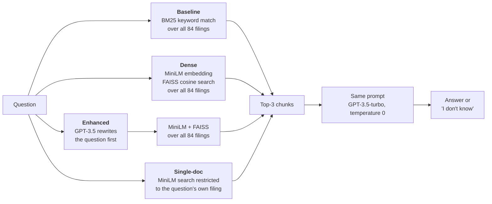
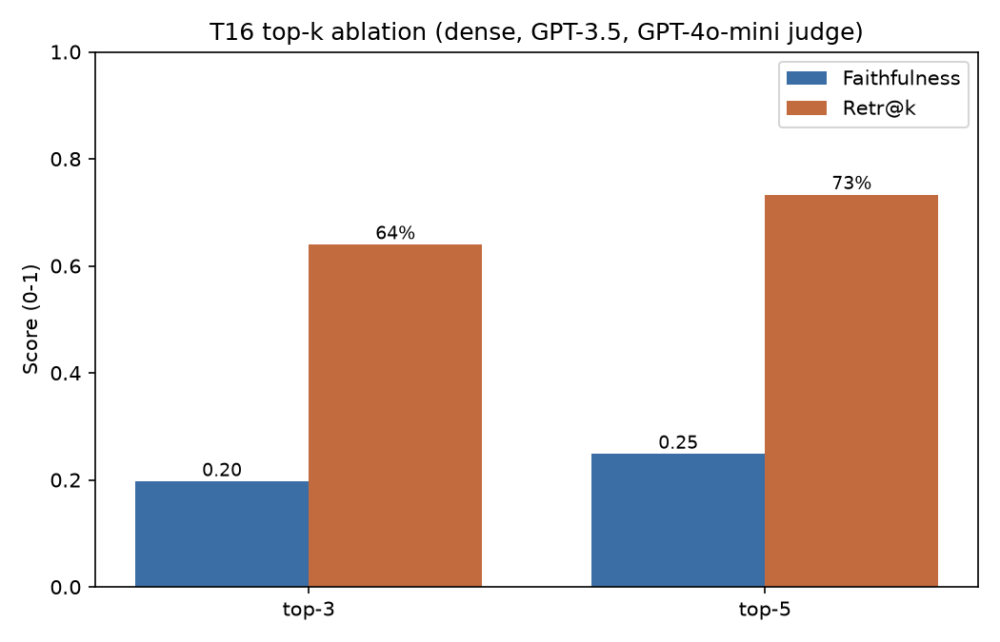
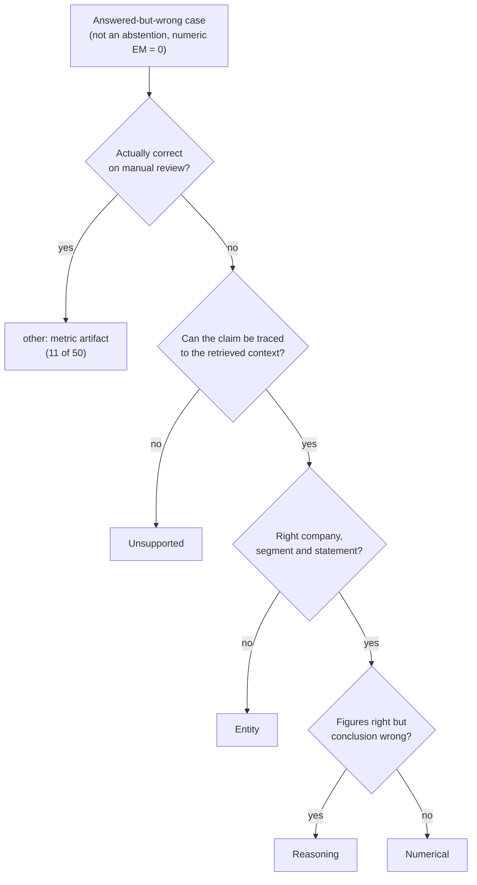
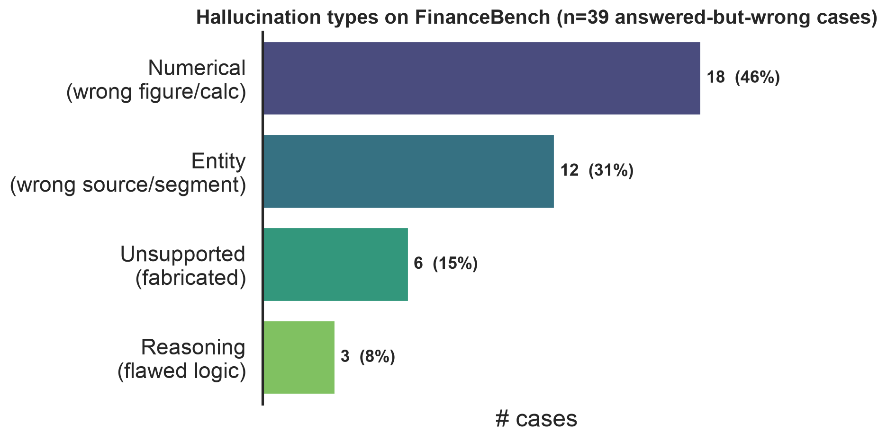
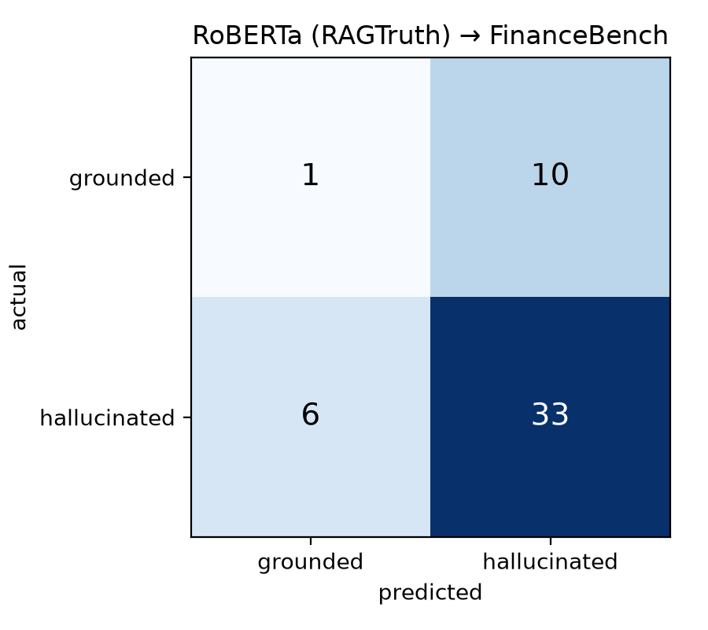

# FinRAG-Hallucination

### Analyzing Hallucination Patterns in RAG-Based Financial Question Answering


**When an AI system answers questions from company financial filings, how often does it make
things up, what kind of mistakes does it make, and what can we change to reduce them?**

This repository is a complete, reproducible testbed for that question. We build several
Retrieval-Augmented Generation (RAG) systems over **84 real SEC filings** (10-Ks, 10-Qs, 8-Ks,
earnings reports), ask them **150 expert-written financial questions** from the
[FinanceBench](https://github.com/patronus-ai/financebench) benchmark, measure how grounded their
answers are, and hand-classify the mistakes.

📄 **[Read the final paper (PDF)](paper/CS6120NLP_Group7_RAG_Hallucination_final_paper.pdf)** ·
🖼️ **[Poster](paper/CS6120NLP_Group7_FinRAG_poster.jpeg)** ·
📊 **[Slides](paper/CS6120NLP_Group7_FinRAG_presentation.pdf)**

---

## Table of contents

1. [The idea in 60 seconds](#the-idea-in-60-seconds)
2. [Key findings](#key-findings)
3. [The dataset and why it is hard](#the-dataset-and-why-it-is-hard)
4. [How the system works](#how-the-system-works)
5. [Experimental design](#experimental-design)
6. [How we measure hallucination](#how-we-measure-hallucination)
7. [Results](#results)
8. [What kinds of hallucinations happen?](#what-kinds-of-hallucinations-happen)
9. [Can hallucinations be detected automatically?](#can-hallucinations-be-detected-automatically)
10. [Quickstart: reproduce everything](#quickstart-reproduce-everything)
11. [Repository structure](#repository-structure)
12. [Limitations and future work](#limitations-and-future-work)
13. [Team](#team)
14. [Acknowledgements and references](#acknowledgements-and-references)

---

## The idea in 60 seconds

Large language models (LLMs) like GPT are fluent, but they sometimes state things that are not
true. **Retrieval-Augmented Generation (RAG)** is the standard fix: before answering, the system
*looks up* relevant passages from trusted documents and tells the model to answer **only** from
them.



Even with RAG, models still **hallucinate**: they produce claims that contradict the retrieved
text or go beyond it. In finance this is costly. Answers are exact numbers buried in long,
table-heavy reports, so one wrong digit, year, or company gives a confidently wrong answer.

We ask three research questions:

| | Research question |
|---|---|
| **RQ1** | How often do different RAG configurations hallucinate on financial QA, and what drives the differences? |
| **RQ2** | Which hallucination **types** dominate in finance: numerical, entity, reasoning, or unsupported? |
| **RQ3** | Does an open, smaller LLM hallucinate *less* than GPT-3.5 when given the *exact same* retrieved context? |

---

## Key findings

> **1. Retrieval is the main lever (RQ1).** Better retrieval improves *everything*. The share of
> questions where the correct filing appears in the top-3 results rises **43% → 64% → 69%**
> (BM25 → dense → query-rewrite). Answered questions rise in step (**47 → 82 → 87** of 150), and
> so do faithfulness (**0.10 → 0.20 → 0.21**) and numeric accuracy (**0.12 → 0.18 → 0.21**).

> **2. Most hallucinations are about numbers (RQ2).** Of 39 genuine hallucinations,
> **46% are numerical** (wrong value, unit, or period), **31% entity** (wrong company or filing),
> **15% unsupported** (made up), and **8% reasoning** (right inputs, wrong conclusion).

> **3. A smaller open model was *more* faithful (RQ3).** On identical context,
> **Mistral-7B-Instruct** scored **0.59 faithfulness vs. 0.21** for GPT-3.5-turbo and nearly
> doubled numeric accuracy (0.37 vs. 0.21). It did this by **abstaining more**: it answered 69
> questions where GPT-3.5 answered 87. On this benchmark, *knowing when to say "I don't know"*
> mattered more than model size.

> **4. Automatic metrics over-flag.** About **22%** (11 of 50) of answers that automatic scoring
> flagged as wrong were actually **correct**. The metric missed a formatting variant such as
> "$1,577 million" vs. "1.577 billion". Human review is still necessary.

<p align="center">
  
  <br><em>Project poster: a one-page visual summary. The tables below are the authoritative numbers.</em>
</p>

---

## The dataset and why it is hard

We use the open-source subset of **FinanceBench** ([Islam et al., 2023](https://arxiv.org/abs/2311.11944)),
loaded from HuggingFace (`PatronusAI/financebench`):

| | |
|---|---|
| Questions | **150** human-annotated QA pairs (50 metrics-generated, 50 domain-relevant, 50 novel-generated) |
| Companies / sectors | **32** companies across **9** GICS sectors |
| Source documents | **84** filings (112 questions on 10-Ks, 15 on 10-Qs, 14 on earnings reports, 9 on 8-Ks), fiscal years 2015–2024 |
| Each record has | question, gold answer, gold evidence passage(s), page numbers, source filing |

Our exploratory analysis ([`notebooks/01_eda.ipynb`](notebooks/01_eda.ipynb),
[`results/eda_summary.md`](results/eda_summary.md)) shows four properties that make this a stress
test for grounded generation:

1. **Long, tabular documents.** The median filing is **128 pages**, and **69%** of the evidence is table-heavy.
2. **Short, numeric answers.** The median gold answer is **9 words**, and **84%** are numeric. One wrong figure flips right to wrong.
3. **Answers must be computed, not copied.** Only **2%** of gold answers appear verbatim in the evidence, and **46%** of questions need calculation or aggregation.
4. **Vocabulary gap.** The median question–evidence cosine similarity is **0.47**, so the retriever must bridge different wording.

<p align="center">
  
</p>

<p align="center">
  
  <br><em>Hallucination-risk proxies: 98% of answers are not verbatim in the evidence.</em>
</p>

---

## How the system works

### End-to-end architecture



### The four retrieval strategies

Every pipeline shares the **same generator, prompt, chunks, and top-3 setting**. Only the way
passages are found changes:



| Pipeline | Script | What it tests |
|---|---|---|
| **Baseline (BM25)** | [`pipeline_baseline.py`](src/pipeline_baseline.py) | Sparse lexical retrieval (Okapi BM25), the classic baseline |
| **Dense (FAISS)** | [`pipeline_dense.py`](src/pipeline_dense.py) | Semantic retrieval. Inner product on L2-normalized vectors equals cosine similarity |
| **Enhanced (rewrite)** | [`pipeline_enhanced.py`](src/pipeline_enhanced.py) | An LLM spells out abbreviations and adds filing line-item terms before dense search ([examples](results/query_rewrite_examples.md)) |
| **Single-doc (oracle)** | `pipeline_dense.py --scope single_doc` | Upper bound: the right filing is guaranteed, so this isolates *reading* difficulty from *finding* difficulty |
| **Mistral-7B** | [`pipeline_mistral.py`](src/pipeline_mistral.py) | Reuses the Enhanced run's exact retrieved contexts and swaps only the generator |

**Why search all 84 filings instead of just the right one?** In a real deployment the system
does not know which filing holds the answer. A retriever that can surface the *wrong*
company's filing is exactly where hallucinations come from, which is what we want to study.

### The prompt

All generators get the same instruction, at temperature 0 so results are deterministic:

```text
You are a financial analyst. Answer the question using ONLY the context below, which is taken
from company SEC filings. If the answer is not in the context, say "I don't know." Be concise
and cite the figure exactly as it appears.

Context:
{top-3 chunks, separated by ---}

Question: {question}
Answer:
```

Because the model may abstain, a **wrong** answer is a grounding failure, not a guess from memory.

---

## Experimental design

Each experiment changes **one** factor and holds everything else fixed, so each effect can be
attributed to its cause:

| Experiment | What changes | Held fixed | Answers |
|---|---|---|---|
| Retrieval comparison | BM25 → Dense → Enhanced → Single-doc | GPT-3.5, prompt, 512-tok chunks, top-3 | RQ1 |
| Top-k ablation | top-3 vs. top-5 | Dense retrieval, GPT-3.5, 512-tok chunks | RQ1 |
| Chunk-size ablation | 256 vs. 512 tokens | Dense retrieval, GPT-3.5, top-3 | RQ1 |
| Generator comparison | GPT-3.5-turbo vs. Mistral-7B-Instruct | **Identical** retrieved contexts and prompt | RQ3 |
| Error analysis | — (manual labeling) | 50 answered-but-wrong Enhanced cases | RQ2 |

---

## How we measure hallucination

No single number captures "hallucination", so we report two families of metrics. **RAGAS** checks
*grounding*: is the answer supported by the context? **QA metrics** check *correctness*: does the
answer match the human gold answer? An answer can be faithful to the wrong context and still be
wrong, so we need both.

| Metric | Plain-English meaning | Implementation |
|---|---|---|
| **Retr@k** | Did *any* of the top-k chunks come from the correct filing? (document-level hit) | `build_results_table.py` |
| **Faithfulness** | Share of the answer's claims supported by the retrieved context. **Low = hallucination** | RAGAS, judge = GPT-4o-mini |
| **Faith(ans)** | Faithfulness over *answered* questions only. An "I don't know" has nothing to ground | `build_results_table.py` |
| **Answer relevancy** | Does the answer actually address the question? | RAGAS, local MiniLM embeddings |
| **Context precision** | Were the useful chunks ranked near the top? | RAGAS |
| **Answered** | Questions where the model did not abstain | `qa_metrics.py` |
| **Token F1** | SQuAD-style word overlap with the gold answer | `qa_metrics.py` |
| **EM (num)** | **Numeric-tolerant exact match**: the gold number appears in the answer within ±1%, ignoring format and units ("$1,577" = "1577.00" = "1.577 billion") | `qa_metrics.py` |

> **Why numeric-tolerant EM?** Strict SQuAD exact match is ~0 for every pipeline, because
> financial figures are written in many formats. Numeric-tolerant EM shows that **33–42% of
> answered questions are actually correct**. The strict metric was penalizing formatting, not
> wrong answers.

---

## Results

All runs use the full 150-question set. Generator = GPT-3.5-turbo (temperature 0) unless noted.
RAGAS judge = GPT-4o-mini. Higher is better for every column.

### RQ1: Retrieval strategy comparison

| Pipeline | Retr@3 | Faithful. | Faith(ans) | Ans. Rel. | Ctx. Prec. | Answered | F1 | EM (num) |
|---|---|---|---|---|---|---|---|---|
| Baseline (BM25) | 43% | 0.104 | 0.408 | 0.234 | 0.240 | 47/150 | 0.083 | 0.120 |
| Dense (FAISS) | 64% | 0.197 | 0.352 | 0.414 | 0.417 | 82/150 | 0.116 | 0.180 |
| Enhanced (rewrite) | **69%** | **0.209** | 0.353 | **0.432** | **0.462** | **87/150** | **0.121** | **0.207** |
| *Dense, single-doc (oracle)* | *100%* | *0.300* | *0.572* | *0.424* | *0.435* | *96/150* | *0.139* | *0.267* |

**How to read it:** only retrieval changed between rows, so the steady improvement isolates
retrieval quality as the driver. The oracle row shows the ceiling. Even with the right filing
guaranteed, about a third of questions go unanswered, so finding the right filing is
*necessary but not sufficient*.

### Retrieval-depth (top-k) ablation

| Top-k | Retr@k | Faithful. | Faith(ans) | Ans. Rel. | Ctx. Prec. | Answered | F1 | EM (num) |
|---|---|---|---|---|---|---|---|---|
| 3 | 64% | 0.197 | 0.352 | 0.414 | **0.417** | 82/150 | 0.116 | 0.180 |
| 5 | **73%** | **0.248** | **0.397** | **0.468** | 0.388 | **97/150** | **0.126** | **0.220** |

<p align="center">
  
</p>

Retrieving more chunks raises recall and faithfulness. Context precision dips slightly because
more chunks are admitted, but the net effect is positive. Retrieval recall is the binding
constraint.

### Chunk-size ablation

| Chunk (tokens) | Retr@3 | Faithful. | Ans. Rel. | Ctx. Prec. | Answered | F1 | EM (num) |
|---|---|---|---|---|---|---|---|
| 256 | 59% | 0.234 | 0.324 | 0.288 | 70/150 | 0.095 | 0.160 |
| 512 | **64%** | 0.197 | **0.414** | **0.417** | **82/150** | **0.116** | **0.180** |

Smaller chunks cut a figure off from its row and column labels, which hurts retrieval and
accuracy. Their slightly higher faithfulness comes from committing to less. We use 512 tokens
throughout.

### RQ3: Generator comparison on identical context

| Generator | Faithful. | Faith(ans) | Ans. Rel. | Ctx. Prec. | Answered | F1 | EM (num) |
|---|---|---|---|---|---|---|---|
| GPT-3.5-turbo | 0.209 | 0.353 | **0.432** | **0.462** | **87/150** | 0.121 | 0.207 |
| Mistral-7B-Instruct | **0.592** | **0.631** | 0.254 | 0.411 | 69/150 | **0.128** | **0.373** |

Mistral is more faithful even on the answered subset (0.63 vs. 0.35), so the gap is not just an
abstention artifact. Its lower answer relevancy reflects its higher refusal rate: a refusal
scores as "not relevant". **Abstention behavior, not model scale, drives grounding here.**

> Full tables: [`results/pipeline_comparison.md`](results/pipeline_comparison.md) ·
> [`results/t16_sweep_results.md`](results/t16_sweep_results.md) ·
> [`results/chunk_size_results.md`](results/chunk_size_results.md) ·
> [`results/generator_comparison.md`](results/generator_comparison.md) ·
> raw scores in [`eval_ragas.csv`](results/eval_ragas.csv) and [`eval_qa_metrics.csv`](results/eval_qa_metrics.csv)

---

## What kinds of hallucinations happen?

From the Enhanced pipeline, our strongest deployable configuration, we drew **50
answered-but-incorrect cases**: the model committed to an answer, but numeric-tolerant EM = 0.
The sample is stratified across question types. Each case got one primary label:

| Type | Definition | Example |
|---|---|---|
| **Numerical** | Right entity and intent, **wrong value**: miscalculation, wrong unit or period, misread table | General Mills FY2020 free cash flow: **$25,825M** vs. gold **$3,215M** |
| **Entity** | Right-looking answer from the **wrong source**: company, segment, or statement | Asked what drove *AMD's* revenue, answered with *Lockheed Martin F-16/F-22* text |
| **Unsupported** | A claim **not traceable** to any retrieved passage | Named a specific registered security, but the gold answer is "there are none" |
| **Reasoning** | Inputs are correct, the **inference** is wrong | Verizon debt "increased", because it compared 2020→2021 instead of 2021→2022 |

<details>
<summary><b>Simplified labeling guide (click to expand)</b></summary>



Full definitions and decision hints: [`annotations/TAXONOMY.md`](annotations/TAXONOMY.md).
Labeled sheet: [`annotations/failure_cases_50.csv`](annotations/failure_cases_50.csv).
</details>

**Result:** 11 of the 50 flagged cases were actually correct answers that the metric mis-scored.
Among the remaining **39 genuine hallucinations**:

<p align="center">
  
</p>

The hardest part is producing the **right number from the right place**, not long chains of
logic. Entity errors, the second most common, are mostly retrieval failures: the model answered
confidently from the wrong filing. This ties RQ2 back to the retrieval bottleneck in RQ1.

<details>
<summary><b>Case studies: two per type (click to expand)</b></summary>

| Type | Company | Question | Model answer | Gold | Why it is wrong |
|---|---|---|---|---|---|
| Numerical | General Mills | FY2020 free cash flow | $25,825 million | $3,215 | order-of-magnitude error |
| Numerical | Coca-Cola | FY2022 dividend payout ratio | 42.68% | 0.80 (80%) | wrong dividends figure |
| Entity | AMD | What drove FY22 revenue change? | Lockheed F-16/F-22 program volume | AMD EPYC / semi-custom sales | answered from the wrong company's filing |
| Entity | Amex | Geographies it operates in (2022) | Phoenix, Sunrise, Gurgaon, … | US, EMEA, APAC, LACC | listed office cities, not operating regions |
| Unsupported | Amex | Debt securities registered to trade | a specific deferred-comp plan | there are none | fabricated a security |
| Unsupported | Pfizer | Spinning off large segments (Q2'23)? | not spinning off any | Yes, Upjohn | contradicts the filing |
| Reasoning | Verizon | Did debt increase 2021→2022? | Yes (used 2020→2021) | No, it decreased | compared the wrong fiscal years |
| Reasoning | 3M | Capital-intensive in FY2022? | Yes | No | opposite interpretation of the same figures |

Source: [`results/case_studies.md`](results/case_studies.md)
</details>

---

## Can hallucinations be detected automatically?

As a proof of concept, we fine-tuned **`roberta-base`** as a binary *hallucinated vs. grounded*
classifier on the QA subset of [RAGTruth](https://github.com/ParticleMedia/RAGTruth): 5,034
training responses, 2 epochs, class-weighted loss, max length 256. We then applied it
**zero-shot** to our 50 labeled FinanceBench cases.

| Eval set | N | Accuracy | Precision | Recall | F1 |
|---|---|---|---|---|---|
| RAGTruth-QA test | 900 | 0.480 | 0.244 | 0.919 | 0.386 |
| FinanceBench-50 (transfer) | 50 | 0.680 | 0.767 | **0.846** | **0.805** |

<p align="center">
  
</p>

The detector catches **33 of 39** hallucinations but clears only **1 of 11** grounded answers. It
is a high-recall **over-flagger**: useful as a first-pass filter that rarely misses a
hallucination, but too imprecise to trust on its own.

---

## Quickstart: reproduce everything

### Prerequisites

- **Python 3.10+**
- An **OpenAI API key** with billing enabled. It is used for the GPT-3.5 generator, the query
  rewriter, and the GPT-4o-mini RAGAS judge.
- *(RQ3 only)* [**Ollama**](https://ollama.com) to run Mistral-7B locally. No GPU or key is needed.
- About 400 MB of disk for the filing PDFs.

### 1. Set up the environment

```bash
git clone https://github.com/piyush1420/finrag-hallucination.git
cd finrag-hallucination

python -m venv .venv
source .venv/bin/activate          # Windows: .venv\Scripts\activate
pip install --upgrade pip
pip install -r requirements.txt    # bitsandbytes is skipped on macOS (not needed)

cp .env.example .env               # then edit .env (see below)
python src/check_setup.py          # verifies imports, .env, and one tiny API call
```

In `.env`, paste your `OPENAI_API_KEY` and **set `LLM_BACKEND=openai`**.

> ⚠️ The template defaults to `LLM_BACKEND=ollama`, which runs a local Llama model instead of
> GPT-3.5. That is handy for free experiments, but it will not reproduce the paper. You can also
> pass `--backend openai` explicitly on every command, as shown below. **Never commit `.env`.**
> More detail is in [SETUP.md](SETUP.md).

### 2. Download the data

```bash
python src/download_data.py        # 150 QA records + 84 filing PDFs  →  data/raw/, data/pdfs/
```

Downloads resume where they stopped, so re-running only fetches missing PDFs. Use `--skip-pdfs`
for a fast metadata-only download. Nothing in `data/` is committed. See [data/README.md](data/README.md).

### 3. Chunk the filings

```bash
python src/preprocess.py --strategy fixed_512   # → data/processed/chunks_fixed_512.parquet (21,876 chunks)
```

### 4. Run the pipelines

Each command writes `results/raw_outputs/<run>.jsonl` plus a `.config.json` sidecar. Add
`--limit 5` for a cheap smoke test.

```bash
python src/pipeline_baseline.py --backend openai                     # → baseline_bm25.jsonl
python src/pipeline_dense.py    --backend openai                     # → dense_faiss.jsonl
python src/pipeline_dense.py    --backend openai --scope single_doc  # → dense_singledoc.jsonl
python src/pipeline_enhanced.py --backend openai                     # → enhanced_rewrite.jsonl

# RQ3: Mistral-7B on the Enhanced run's exact contexts (needs enhanced_rewrite.jsonl first)
ollama pull mistral:7b-instruct
python src/pipeline_mistral.py                                       # → enhanced_mistral.jsonl
```

The first dense run embeds all chunks once and caches them in `data/processed/emb_*.npy`. Later
runs reuse the cache.

### 5. Score every run and build the tables

```bash
for run in baseline_bm25 dense_faiss dense_singledoc enhanced_rewrite enhanced_mistral; do
  python src/evaluate.py   results/raw_outputs/$run.jsonl --backend openai --judge-model gpt-4o-mini
  python src/qa_metrics.py results/raw_outputs/$run.jsonl
done

python src/build_results_table.py     # → results/pipeline_comparison.md
python src/build_generator_table.py   # → results/generator_comparison.md
```

Both scorers update one row per (pipeline, model) in `results/eval_ragas.csv` and
`results/eval_qa_metrics.csv`. They also write per-question scores to `results/raw_outputs/`.

<details>
<summary><b>6. Ablations: top-k and chunk size (click to expand)</b></summary>

```bash
# top-5 retrieval
python src/pipeline_dense.py --backend openai --top-k 5 --out results/raw_outputs/dense_top5.jsonl

# 256-token chunks (--max-tokens is required; the strategy name alone does not set the size)
python src/preprocess.py --strategy fixed_256 --max-tokens 256
python src/pipeline_dense.py --backend openai --chunk-strategy fixed_256 --out results/raw_outputs/dense_256tok.jsonl
```

> ⚠️ **Rename the runs before scoring.** These runs still record `"pipeline": "dense_faiss"` in
> their `.config.json` sidecar. The scorers key results by that name, so they would overwrite
> the main Dense row. Set the name to match the file:
>
> ```bash
> python - <<'EOF'
> import json, pathlib
> for stem in ["dense_top5", "dense_256tok"]:
>     p = pathlib.Path(f"results/raw_outputs/{stem}.jsonl.config.json")
>     cfg = json.loads(p.read_text()); cfg["pipeline"] = stem
>     p.write_text(json.dumps(cfg, indent=2))
> EOF
> ```

Then score both files as in step 5 and build the tables:

```bash
python scripts/build_sweep_table.py   # → results/t16_sweep_results.md + t16_sweep_chart.png
python scripts/build_chunk_table.py   # → results/chunk_size_results.md
```
</details>

<details>
<summary><b>7. Error analysis and the RoBERTa detector (click to expand)</b></summary>

```bash
# Figures and tables from the committed, hand-labeled annotation sheet
python src/plot_hallucination_types.py   # → results/fig_hallucination_types.png + hallucination_type_freq.md
python src/build_case_studies.py         # → results/case_studies.md

# Optional: draw a fresh 50-case sample to label yourself
python src/select_failure_cases.py --out "$PWD/annotations/my_cases.csv"   # use an absolute path
```

> ⚠️ Without `--out`, `select_failure_cases.py` **overwrites** `annotations/failure_cases_50.csv`
> with an *unlabeled* sheet.

**RoBERTa detector.** Download `source_info.jsonl` and `response.jsonl` from the
[RAGTruth `dataset/` folder](https://github.com/ParticleMedia/RAGTruth) into `data/raw/ragtruth/`,
then run:

```bash
python -u src/train_hallucination_classifier.py                         # full run (Apple MPS or CPU)
python -u src/train_hallucination_classifier.py --max-train 300 --epochs 1   # quick smoke test
```
</details>

### Output schema

Every pipeline writes the same row shape, so one evaluation harness scores them all.
Here is an abbreviated example:

```json
{
  "financebench_id": "financebench_id_03029",
  "question": "What is the FY2018 capital expenditure amount (in USD millions) for 3M? ...",
  "contexts": ["<chunk 1 text>", "<chunk 2 text>", "<chunk 3 text>"],
  "retrieved_chunk_ids": ["3M_2018_10K::fixed_512::0123", "..."],
  "generated_answer": "...",
  "gold_answer": "$1577.00",
  "doc_name": "3M_2018_10K",
  "question_type": "metrics-generated"
}
```

Field definitions and the RAGAS column mapping are in [`src/SCHEMA.md`](src/SCHEMA.md).

---

## Repository structure

```
finrag-hallucination/
├── README.md                 ← you are here
├── SETUP.md                  detailed environment + API-key setup
├── requirements.txt          pinned dependencies
├── .env.example              template for secrets (copy to .env, never commit .env)
│
├── src/                      all pipeline + evaluation code
│   ├── download_data.py        fetch FinanceBench QA records + filing PDFs
│   ├── preprocess.py           PDF → text → token-window chunks (parquet)
│   ├── llm.py                  OpenAI / Ollama backend switch (one client interface)
│   ├── schema.py · SCHEMA.md   shared prediction-row schema + run-config sidecar
│   ├── pipeline_baseline.py    BM25 RAG (also defines the shared prompt)
│   ├── pipeline_dense.py       FAISS + MiniLM RAG (+ single-doc oracle)
│   ├── pipeline_enhanced.py    LLM query rewrite + dense RAG
│   ├── pipeline_mistral.py     Mistral-7B generator on reused contexts (RQ3)
│   ├── evaluate.py             RAGAS harness
│   ├── qa_metrics.py           token F1, strict EM, numeric-tolerant EM
│   ├── build_*_table.py        assemble paper-ready Markdown tables
│   ├── select_failure_cases.py stratified 50-case sample for annotation
│   ├── plot_hallucination_types.py · build_case_studies.py
│   ├── train_hallucination_classifier.py   RoBERTa detector (RAGTruth → FinanceBench)
│   └── check_setup.py          environment + API-key sanity check
│
├── scripts/                  ablation table builders (top-k, chunk size)
├── notebooks/
│   ├── 01_eda.ipynb            full exploratory data analysis
│   └── colab_gpu_template.ipynb  optional Colab GPU starter
├── annotations/
│   ├── TAXONOMY.md             hallucination categories + labeling guidelines
│   └── failure_cases_50.csv    the 50 hand-labeled cases
├── results/                  curated tables (.md/.csv) and figures (.png)
├── data/                     downloaded locally, gitignored (see data/README.md)
├── paper/                    final paper (PDF/DOCX/LaTeX), poster, slides, bibliography
└── project_proposal/         original proposal + implementation plan
```

Large or regenerable artifacts are **gitignored**: PDFs, chunk parquet files, embedding caches,
raw model outputs, and model checkpoints.

---

## Limitations and future work

**Limitations**
- **Single annotator.** The 50 cases were labeled by one person (LLM-drafted, every label reviewed by hand), so no inter-annotator agreement (Cohen's κ) is reported.
- **PDF table flattening.** Text extraction linearizes tables, which can separate a number from its row and column headers. This is a plausible source of numerical errors.
- **Scale.** We evaluate the 150-question open subset, not the full 10,231-question FinanceBench.
- **Judge dependence.** RAGAS faithfulness relies on an LLM judge (GPT-4o-mini). Read absolute values comparatively, not as ground truth.

**Future work**
- Table-aware chunking that keeps headers attached to figures
- Stronger retrieval-integrated methods (Fusion-in-Decoder, Self-RAG) to close the recall gap
- A *precise*, calibrated, multi-class detector for the four hallucination types
- Scaling to the full FinanceBench benchmark

---

## Team

Course project for **CS6120 Natural Language Processing**, Northeastern University (Group 7).

| Member | Contributions |
|---|---|
| **Bhalchandra Shinde** | Repository and infrastructure, environment, data pipeline, EDA, dense and query-rewriting pipelines, Mistral-7B generator comparison, error-analysis taxonomy, annotation and figures, literature notes |
| **Anish Kelkar** | Document chunking, baseline BM25 pipeline, evaluation harness (RAGAS + F1/EM), results tabulation |
| **Piyush Daga** | Retrieval-depth (top-k) ablation |
| **Rituraj Singh** | Related-work contributions |

All members contributed to the final paper.

---

## Acknowledgements and references

This project builds on the following datasets, tools, and papers:

- **FinanceBench**: Islam et al., 2023. *FinanceBench: A New Benchmark for Financial Question Answering.* [arXiv:2311.11944](https://arxiv.org/abs/2311.11944)
- **RAG**: Lewis et al., 2020. *Retrieval-Augmented Generation for Knowledge-Intensive NLP Tasks.* NeurIPS.
- **RAGAS**: Es et al., 2024. *RAGAS: Automated Evaluation of Retrieval Augmented Generation.* EACL demo.
- **RAGTruth**: Niu et al., 2024. *RAGTruth: A Hallucination Corpus for Developing Trustworthy Retrieval-Augmented Language Models.* ACL.
- **Sentence-BERT**: Reimers & Gurevych, 2019 (the `all-MiniLM-L6-v2` encoder) · **BM25**: Robertson & Zaragoza, 2009 · **Mistral 7B**: Jiang et al., 2023
- Libraries: [FAISS](https://github.com/facebookresearch/faiss), [rank_bm25](https://github.com/dorianbrown/rank_bm25), [sentence-transformers](https://www.sbert.net), [RAGAS](https://github.com/explodinggradients/ragas), [LangChain](https://github.com/langchain-ai/langchain), [PyMuPDF](https://github.com/pymupdf/PyMuPDF), [Ollama](https://ollama.com), [HuggingFace Transformers](https://github.com/huggingface/transformers)

The full bibliography is in [`paper/references.bib`](paper/references.bib).
